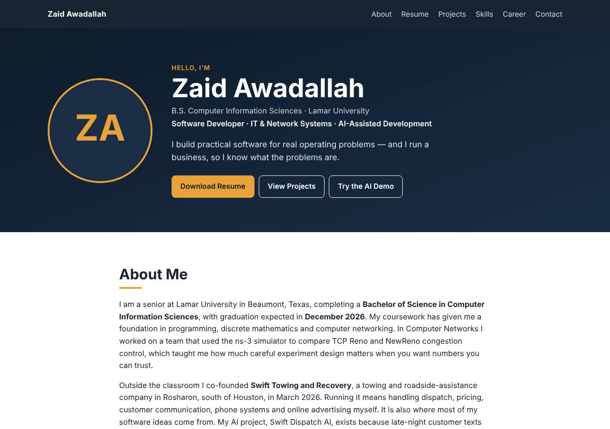

# Zaid Awadallah — Professional Portfolio

**B.S. Computer Information Sciences, Lamar University (December 2026)**
Software Developer · IT & Network Systems · AI-Assisted Development

🌐 **Live site:** https://zaidawadallah.github.io/github-portfolio/
🤖 **AI demo:** https://zaidawadallah.github.io/github-portfolio/projects/swift-dispatch-ai/
📄 **Resume:** [resume.pdf](resume.pdf)



## About
This repository is my professional portfolio for COSC 4272 Senior Seminar. It is a static GitHub Pages website (HTML, CSS, JavaScript; no build step) with my resume, three documented projects, a skills summary and career-readiness documents.

## Projects
| # | Project | Type | Tech | Folder |
|---|---|---|---|---|
| 1 | **Swift Dispatch AI** — turns a customer's tow request into a dispatch ticket, estimate and reply | AI assistant | JavaScript, Claude API (tool use), Node tests | [`projects/swift-dispatch-ai`](projects/swift-dispatch-ai) |
| 2 | **TCP Reno vs NewReno in ns-3** — congestion-control simulation | Course (CPSC 4317) | C++, ns-3, Python | [`projects/ns3-tcp-reno-newreno`](projects/ns3-tcp-reno-newreno) |
| 3 | **ORB Backtest Analyzer** — trading-strategy statistics CLI | Personal | Python, matplotlib, unittest | [`projects/orb-backtest-analyzer`](projects/orb-backtest-analyzer) |

## Repository structure
```
github-portfolio/
├── index.html                  # portfolio website (Home, About, Resume, Projects, Skills, Career, Contact)
├── assets/                     # css, js, images (profile photo, favicon)
├── resume.pdf                  # resume (also in resume/)
├── resume/                     # resume.html (embedded online resume) + resume.pdf
├── projects/
│   ├── swift-dispatch-ai/      # AI project: source, tests, README
│   ├── ns3-tcp-reno-newreno/   # course project
│   └── orb-backtest-analyzer/  # personal project: source, tests, sample data
├── docs/                       # AI prompt log, AI project documentation, job search & skills gap analyses
├── screenshots/                # screenshots used on the site and in READMEs
└── tools/                      # setup and PDF build scripts
```

## Submission documents
| Requirement | File |
|---|---|
| Resume PDF | [`resume.pdf`](resume.pdf) |
| AI Project Documentation | [`docs/AI_Project_Documentation.pdf`](docs/AI_Project_Documentation.pdf) |
| Job Search Analysis | [`docs/Job_Search_Analysis.pdf`](docs/Job_Search_Analysis.pdf) |
| Skills Gap Analysis | [`docs/Skills_Gap_Analysis.pdf`](docs/Skills_Gap_Analysis.pdf) |
| AI Prompt Log | [`docs/AI_Prompt_Log.pdf`](docs/AI_Prompt_Log.pdf) ([Markdown](docs/AI_PROMPT_LOG.md)) |

## Run locally
```bash
python3 -m http.server 8000                                  # http://localhost:8000
cd projects/swift-dispatch-ai && npm test                    # 13 tests
cd projects/orb-backtest-analyzer && python3 -m unittest -v  # 7 tests
```

## Deploy to GitHub Pages
1. Create a **public** repository named `github-portfolio` and push this folder to `main`.
2. **Settings → Pages → Build and deployment → Source: Deploy from a branch → `main` / `(root)`** → Save.
3. The site appears at `https://zaidawadallah.github.io/github-portfolio/` within a few minutes.

## Contact
📧 zawadallah@lamar.edu · 💼 [LinkedIn](https://www.linkedin.com/in/zaid-awad-39a4652b5/) · 🐙 [GitHub](https://github.com/zaidawadallah)

---
Content © 2026 Zaid Awadallah. Code is released under the [MIT License](LICENSE).
