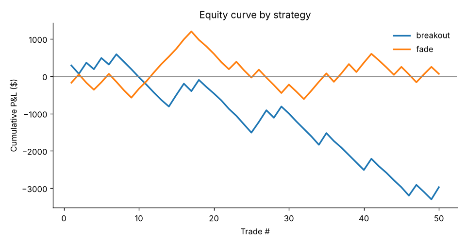

# ORB Backtest Analyzer (Personal Project)

A Python command-line tool that compares variants of an **Opening Range Breakout (ORB)** futures strategy from a trade log — for example trading *with* the breakout versus *fading* it.

I built it because I was comparing these two variants by hand in a spreadsheet and kept making arithmetic mistakes. The tool answers the questions that matter before risking money: *What is my real win rate? What win rate do I need to break even? Is the edge bigger than the noise?*



## Features
- Win rate, average win / loss, **expectancy per trade**, profit factor, net P&L
- **Breakeven win rate** from the observed average win and loss
- **Max drawdown** from the running equity curve
- Day-of-week breakdown, with a warning that small splits are noise
- Small-sample warning (fewer than 30 trades)
- Dollar conversion for any contract (`--point-value 50` for ES, `5` for MES)
- Equity-curve chart (matplotlib) and Markdown report output
- Input validation with clear error messages for bad CSV rows or missing columns

## Usage
```bash
python3 orb_analyzer.py sample_trades.csv
python3 orb_analyzer.py sample_trades.csv --point-value 50 --contracts 1 --chart equity.png --out report.md
```

CSV format:
```
date,strategy,direction,result_points
2026-08-31,breakout,long,6.25
2026-08-31,fade,short,-4.0
```

## Tests
```bash
python3 -m unittest -v test_orb_analyzer
```
7 unit tests cover counting, expectancy, profit factor, breakeven math, drawdown, weekday splits, CSV parsing and error handling.

## Sample data
`sample_trades.csv` is **synthetic** (generated by `tools/make_sample_trades.py` with a fixed seed). It is not a record of real trades. See `sample_report.md` for the output.

## Technologies
Python 3 · `csv`, `dataclasses`, `argparse` (standard library) · matplotlib · unittest

## What I learned
A higher win rate alone does not mean a better strategy. The breakeven win rate depends on the ratio of average win to average loss, so both numbers must be read together. Small samples also produce convincing-looking patterns that disappear with more data.
