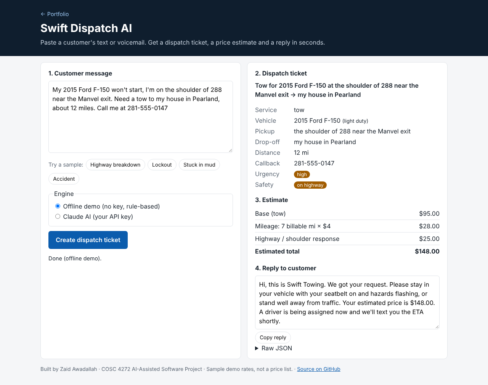

# Swift Dispatch AI — Tow Request Intake Assistant (AI Project)

**Live demo:** https://zaidawadallah.github.io/github-portfolio/projects/swift-dispatch-ai/

A web app that turns a customer's free-text message or voicemail transcript ("my truck died on 288 near Manvel, need a tow to Pearland…") into:

1. a **structured dispatch ticket** — service type, vehicle, pickup, drop-off, distance, callback number, urgency and safety flags
2. a **price estimate** with an itemized breakdown
3. a **ready-to-send SMS reply** that asks only for the information still missing



## Why I built it
I run a towing company. Most calls and texts arrive at night, are short and messy, and leave out key facts. A dispatcher must re-ask for the location, the vehicle and the destination before sending a truck. This tool does the first pass in seconds and makes sure highway breakdowns and injuries are flagged first.

## How it works

```
 customer text ─► Extraction engine ─► Job (JSON, fixed schema) ─► Pricing engine ─► Quote
                  │  Claude (tool use)                          └─► Reply builder ─► SMS draft
                  └─ Offline rule-based (fallback / no key)
```

| Module | Responsibility |
|---|---|
| `src/claude.js` | Calls the Anthropic Messages API with a forced tool call (`record_tow_request`) so the model must return JSON that matches `JOB_SCHEMA`. `normalize()` repairs any partial or invalid field. |
| `src/extract.js` | Offline rule-based extractor (regular expressions) with the same output schema. Used for the no-key demo and as an automatic fallback if the API call fails. |
| `src/pricing.js` | **Deterministic** quote engine. The AI never produces prices; it only extracts facts, so a model cannot invent a number for a customer. |
| `src/reply.js` | Builds the customer SMS, including safety advice (call 911, stay away from traffic) when flags are set. |
| `app.js` / `index.html` | UI, rendering and escaping of all model output before it touches the page. |

### Key design decisions
- **Structured output via tool use**, not free text — the UI can trust the shape of the data.
- **AI extracts, code decides** — prices and surcharges come from a tested rate table.
- **Graceful degradation** — no key, bad key or network error falls back to the offline engine with a visible message.
- **Security** — the API key is typed by the user, held only in page memory, sent only to `api.anthropic.com`, and never stored or committed. All model output is HTML-escaped before rendering.
- **No build step** — plain ES modules, so it runs directly on GitHub Pages.

## Run locally
```bash
cd projects/swift-dispatch-ai
python3 -m http.server 8000      # then open http://localhost:8000
npm test                         # 13 unit tests (Node 18+)
```
To use the Claude engine, choose **Claude AI**, paste an Anthropic API key and click **Create dispatch ticket**. The offline demo needs no key.

## Tests
`tests/dispatch.test.mjs` (Node's built-in test runner) covers service detection, vehicle parsing (including two-word models and medium-duty trucks), highway and hazard flags, missing-information questions, every pricing rule (mileage, class multiplier, highway and night surcharges), normalization of bad AI output and the reply text.

## Sample rates (demo only)
| Service | Base | Notes |
|---|---|---|
| Tow | $95 | + $4/mi after 5 mi |
| Accident recovery | $250 | + $5/mi after 5 mi |
| Jump start / Lockout | $75 | |
| Tire change | $85 | |
| Fuel delivery | $80 | + $15 fuel |
| Winch-out | $150 | |
| Medium duty | ×1.6 | Motorcycle ×1.15 |
| Highway response | +$25 | After hours (9 PM–6 AM) +$35 |

## Limitations and next steps
- The offline engine handles common phrasing only; the Claude engine handles messy, real-world text much better.
- Distance is taken only from what the customer says. Next step: geocode pickup and drop-off and compute road miles with a maps API.
- Next step: a small backend (serverless function) so the API key lives on the server instead of in the browser.
- Next step: speech-to-text for voicemails.

## AI-assisted development
Built with Claude as a pair programmer. The full prompt log, what I accepted, what I changed and why is in [`docs/AI_PROMPT_LOG.md`](../../docs/AI_PROMPT_LOG.md).

## Technologies
JavaScript (ES modules) · HTML5 · CSS3 · Anthropic Claude API (Messages API, tool use / structured output) · Node.js test runner · GitHub Pages
